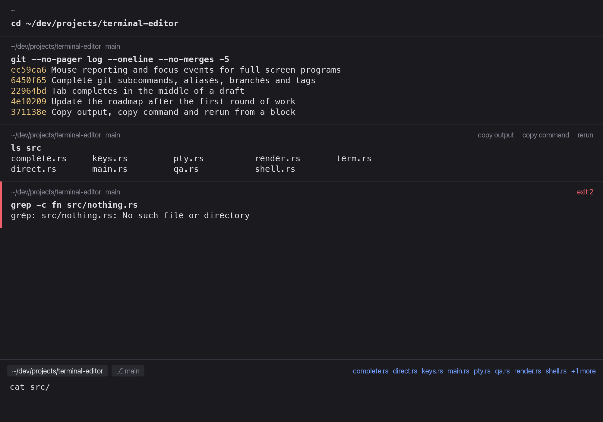

# Nib



Nib is a terminal for macOS. Every command you run gets a card with the folder it ran in, the command, and its output. The card also shows how long the command took once that passes a tenth of a second, and the exit code in red when it fails.

You type in a text box at the bottom of the window instead of on the prompt line, so a command can be edited like any text before it runs. Click to move the cursor, or select a word and type over it. Shift+Enter starts a new line and Enter sends it.

When a program in front of the shell is reading input, like a REPL or a nested shell, keys go straight to that program. Clicking on its input line walks its cursor there, and selecting text in that line and typing replaces it.

## What works

- Blocks in zsh and bash. The hooks print OSC 133 marks where each prompt and command starts, and OSC 7 with the current folder. zsh starts through a small ZDOTDIR shim that loads your usual .zshenv and .zshrc first. bash starts with an rcfile that loads /etc/profile and your .bash_profile the way a login shell would, and keeps your PROMPT_COMMAND. Other shells run as a plain terminal with no blocks.
- Hover a finished block to copy its output or its command, or to run the command again. A rerun keeps whatever you were typing in the box.
- History with Up and Down while the box is empty, and Tab completion of commands on your PATH and of file paths, at the cursor wherever it is in the draft. After `git`, Tab also knows its subcommands, your git aliases, and branches and tags for checkout, switch, merge, rebase and the like.
- Full screen programs like vim, less and top get the whole window and every key. Programs that ask for the mouse (vim with mouse=a, htop, tmux) get clicks, drags and the wheel; hold Shift to select text instead. Focus reports go to programs that ask for them too.
- 256 color and 24 bit color, wide characters, bracketed paste, scrollback, mouse selection, Cmd+C and Cmd+V.
- The current folder and git branch above the input box.

## Build and run

You need Rust and a Mac. The terminal side uses forkpty from libc, so Linux may work, but it has not been tried.

```
cargo build --release
./target/release/nib
```

Nib runs the shell in $SHELL as a login shell, or /bin/zsh when $SHELL is unset.

## Tests

```
cargo test
```

Some of the tests start a real zsh. Two are ignored by default: one needs your real .zshrc, the other is a probe you run by hand.

`NIB_QA=<dir> ./target/release/nib` runs a scripted check of the real app and writes window snapshots and a PASS/FAIL log into that folder. Part of the script opens Claude Code to test typing into a running program, so that step needs `claude` installed. It types and clicks in Claude Code's input box but never sends a prompt. Add `NIB_QA_DEMO=1` for the short run that takes the screenshot above.

## Built with

Rust, iced 0.14 for the window and drawing, vte for parsing what programs print, forkpty from libc for the pseudo terminal, and tokio for timers.

## Plans

See ROADMAP.md.

## License

MIT. See LICENSE.
